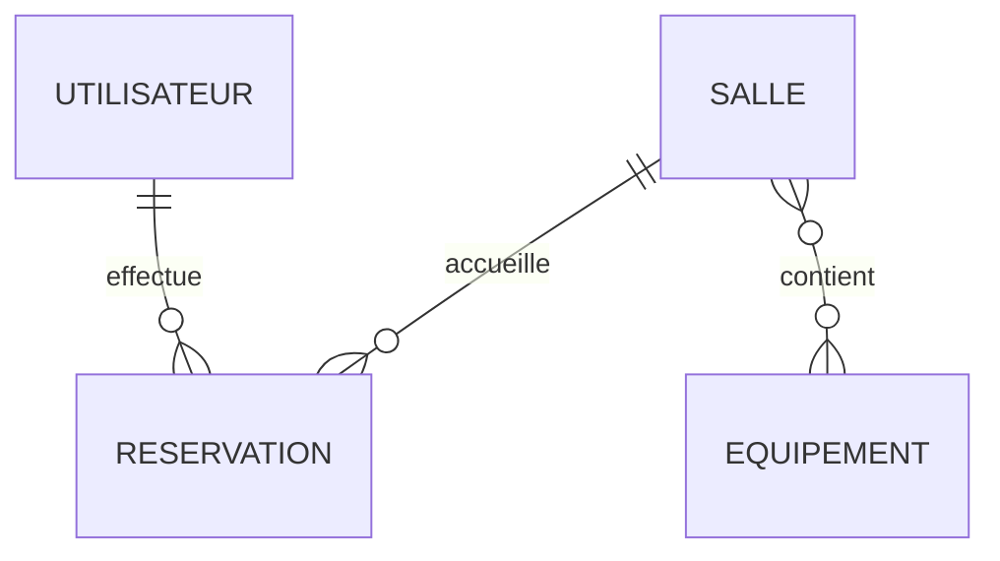
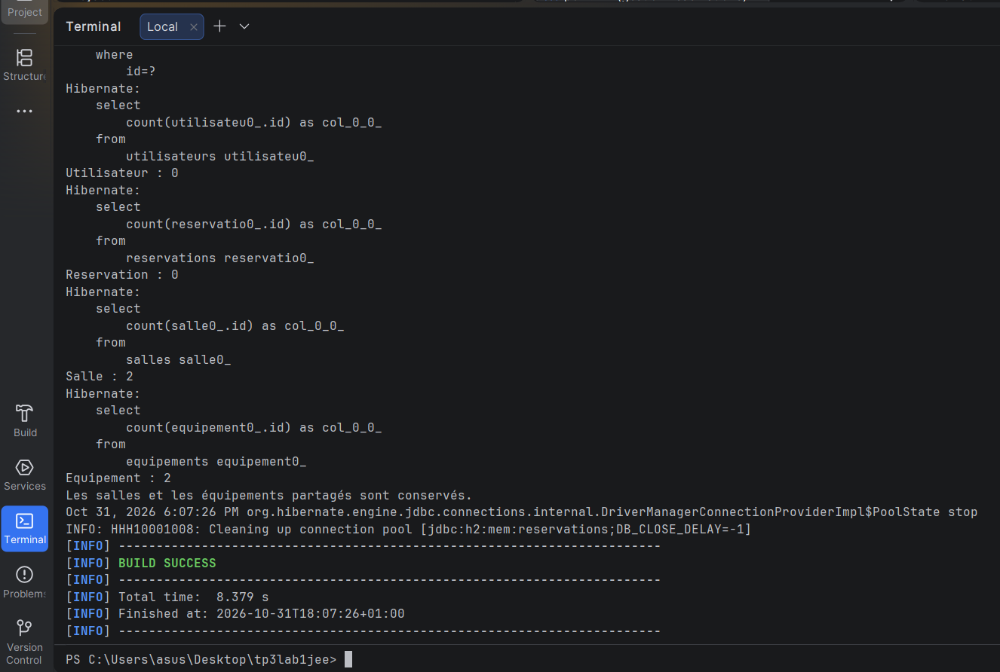
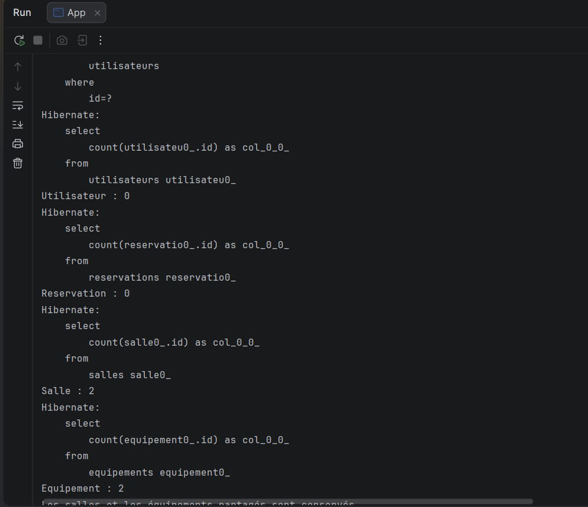
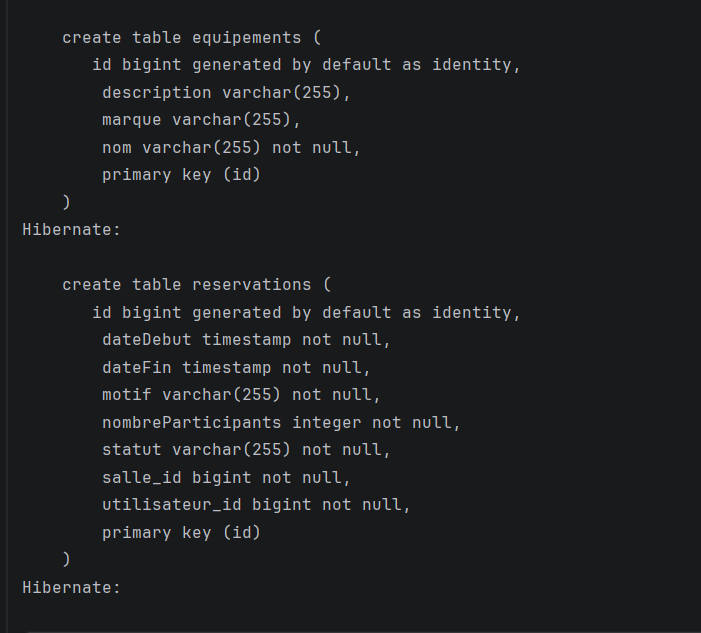
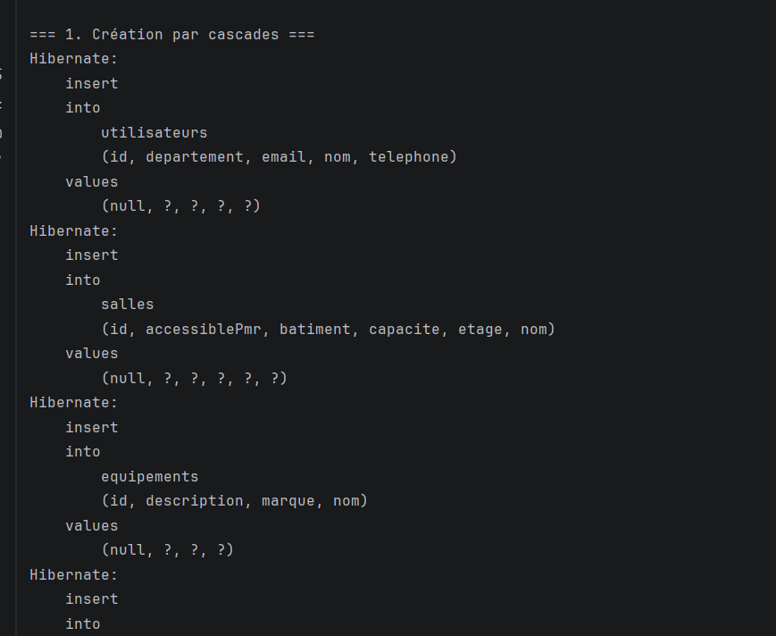

# TP 3 — Gestion des réservations avec JPA et Hibernate

Application console Java réalisée dans le cadre du TP de gestion avancée des entités **Utilisateur**, **Réservation**, **Salle** et **Équipement**. Elle illustre les associations bidirectionnelles, les cascades, la suppression des orphelins et les requêtes JPQL.

> Projet préparé sans compilation, sans tests et sans exécution. Les résultats ci-dessous sont attendus et restent à confirmer lors de votre exécution locale.

## Technologies et prérequis

- JDK 11 recommandé pour ce TP ; Maven 3.6 ou supérieur.
- JPA 2.2 (`javax.persistence`), Hibernate 5.4.30.Final, H2 1.4.200.
- Base H2 en mémoire : les données disparaissent à l'arrêt du processus Java.

Les versions des dépendances reprennent celles de l'énoncé pédagogique.

## Organisation

```text
src/main/java/com/example/
├── App.java                         # Scénario console et transactions
├── model/
│   ├── Utilisateur.java
│   ├── Salle.java
│   ├── Reservation.java
│   ├── Equipement.java
│   └── StatutReservation.java
└── service/ReservationService.java   # Disponibilité et requêtes JPQL
src/main/resources/META-INF/persistence.xml
docs/screenshots/                     # Captures à ajouter après exécution
```

## Champs ajoutés pour personnaliser le TP

| Entité | Champs supplémentaires |
| --- | --- |
| Utilisateur | Téléphone, département |
| Salle | Capacité, bâtiment, étage, accessibilité PMR |
| Équipement | Marque, description |
| Réservation | Motif, date de début, date de fin, nombre de participants, statut |

Les statuts sont stockés sous forme de texte : `EN_ATTENTE`, `CONFIRMEE`, `ANNULEE`.
Les réservations imposent un motif renseigné, une date de début antérieure à la fin et un nombre de participants positif respectant la capacité de la salle.

## Relations et cascades



| Association | Configuration et effet |
| --- | --- |
| Utilisateur → Réservations | `OneToMany`, `ALL`, `orphanRemoval = true` : création et suppression propagées |
| Réservation → Utilisateur | `ManyToOne`, propriétaire de la clé étrangère, sans cascade |
| Réservation → Salle | `ManyToOne`, cascade `PERSIST` : permet la création initiale du graphe sans supprimer une salle lors de la suppression d'une réservation |
| Salle → Réservations | `OneToMany(mappedBy = "salle")`, sans cascade |
| Salle ↔ Équipement | `ManyToMany`, table `salle_equipement`, cascades `PERSIST` et `MERGE` uniquement |

`Salle` possède la relation ManyToMany ; `Equipement` utilise `mappedBy`. Les clés étrangères des réservations sont obligatoires. Les méthodes d'association synchronisent les deux côtés ; les collections exposées sont non modifiables. Pour retirer une réservation, utiliser `utilisateur.removeReservation(...)` dans une transaction : l'entité devient orpheline et Hibernate la supprime.

## Exécution locale

Depuis la racine du dépôt :

```bash
mvn compile exec:java
```

Dans un IDE, importer `pom.xml` comme projet Maven, sélectionner un JDK 11 et lancer `com.example.App`.

La classe `App` utilise des transactions locales avec rollback en cas d'exception et ferme les ressources JPA. Les requêtes SQL sont visibles grâce à `hibernate.show_sql` et `hibernate.format_sql`.

## Scénario et résultats attendus

Les données sont fictives. Un projecteur est associé à deux salles : il représente ici un type d'équipement disponible dans chaque salle, pas un appareil physique unique déplacé entre elles.

| Étape | Utilisateurs | Réservations | Salles | Équipements |
| --- | ---: | ---: | ---: | ---: |
| Création du graphe | 1 | 1 | 2 | 2 |
| Modification et seconde réservation | 1 | 2 | 2 | 2 |
| Suppression d'une réservation orpheline | 1 | 1 | 2 | 2 |
| Suppression de l'utilisateur | 0 | 0 | 2 | 2 |

Le scénario affiche les salles équipées d'un projecteur, les réservations d'un utilisateur et la disponibilité : `false` sur le créneau occupé, `true` sur le créneau suivant. Il modifie ensuite le département et le statut avant de montrer les suppressions.

### Captures des résultats d'exécution





## Approfondissements et limites

La disponibilité repose sur le chevauchement `début existant < fin demandée` et `fin existante > début demandé`. Deux créneaux consécutifs sont autorisés ; une réservation annulée ne bloque pas une salle. Le service suppose des utilisateurs et salles déjà persistés et des écritures dans une transaction active.

Ce contrôle convient au scénario console séquentiel. Une application multiutilisateur nécessiterait une stratégie de verrouillage pour empêcher deux réservations concurrentes. Les validations Java et les callbacks JPA ne remplacent pas toutes les contraintes d'une application de production.

`hibernate.hbm2ddl.auto=update` et l'affichage SQL sont conservés pour observer le TP. Ce dépôt contient une démonstration console JPA, sans serveur JEE ni interface web.

## Dépôt GitHub

Le fichier `.gitignore` exclut les fichiers de compilation et les configurations locales des IDE. Ajouter les captures et compléter cette documentation après l'exécution, puis publier depuis la racine :

```bash
git init
git add .
git commit -m "Réalisation du TP 3 : gestion des réservations JPA"
git branch -M main
git remote add origin https://github.com/VOTRE_COMPTE/gestion-reservations.git
git push -u origin main
```

Créer auparavant un dépôt GitHub vide et remplacer `VOTRE_COMPTE` par votre identifiant. Si le dépôt local est déjà initialisé ou possède déjà un remote, adapter les commandes correspondantes.
